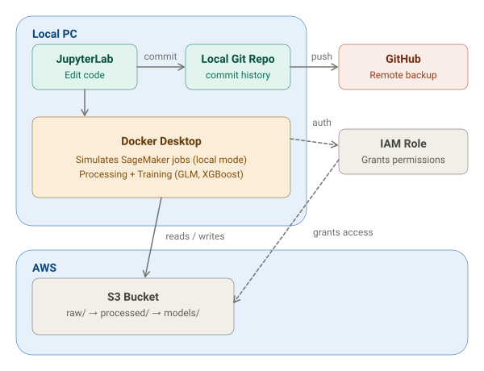

# Insurance-Underwriting-Pricing-Model


A production-oriented machine learning project that predicts auto insurance claim frequency and severity to support underwriting and pricing decisions, built with production ML practices in mind from data pipeline to model validation, governance, and fairness auditing. Deployment and live monitoring are on the roadmap (see [Scope and roadmap](#scope-and-roadmap)).

**Why this project:** Insurers are under increasing regulatory pressure to make pricing models explainable and free of discriminatory bias. This project goes beyond a single trained model to demonstrate the fuller lifecycle a real insurer requires: validated data, a defensible modeling approach, fairness testing, and drift monitoring.

**Approach:**

- Predicts claim frequency and severity using the French Motor Third-Party Liability dataset (freMTPL2freq/sev) and combines them into a pure premium.
- Compares a baseline GLM (champion) against an XGBoost model (challenger) using actuarial-standard validation (exposure-weighted Gini, lift and double-lift charts) rather than naive A/B testing.
- Includes an explainability layer (SHAP) and fairness testing (calibration by group and disparate impact analysis) before the challenger is promoted. An automated promotion gate in CI checks the recorded results.
- Registers both models in the SageMaker Model Registry with their metrics, data fingerprints, and approval status.
- Monitors for data drift with a PSI/KS monitor that issues a retrain decision when drift is detected. The monitor runs locally and does not retrain automatically.

**Tech stack:** Python (pandas, scikit-learn, statsmodels, XGBoost), Docker, AWS (S3, IAM, SageMaker Processing, Training, and Model Registry), GitHub Actions for CI.

## Results

Frequency (exposure-weighted Gini, held-out test set):

| Model | Gini |
|---|---|
| Champion: Poisson GLM (tree-based bins + interaction) | 0.2976 |
| Challenger: XGBoost (`count:poisson`, depth 5, eta 0.2, 100 rounds) | 0.3348 |

Pure premium (frequency × severity):

| Model | Pure premium Gini | Predicted ÷ actual loss* |
|---|---|---|
| Champion (GLM frequency × GLM severity) | 0.259 | 1.063 |
| Hybrid (XGBoost frequency × GLM severity) | 0.302 | 1.059 |
| Challenger (XGBoost frequency × XGBoost severity) | 0.306 | 1.013 |

\*Adjusted for a claim-count mismatch between the frequency and severity files (7,089 counted claims vs 5,247 with an amount in the test set).

Key findings:

- **The challenger wins where the models disagree.** In the double-lift chart, in the buckets where XGBoost and the GLM differ most, XGBoost's predictions match actual claim frequency and the GLM's do not.
- **Frequency does the work.** XGBoost frequency adds 0.043 pure premium Gini; XGBoost severity adds only 0.004.
- **The champion is a strengthened baseline, not a weak one.** The GLM went from Gini 0.2460 to 0.2478 to 0.2976. Nearly all of the gain came from binning four continuous variables on tree-derived cut points, which captured the stepwise effect of BonusMalus.
- **Explainability (SHAP):** BonusMalus, vehicle age, and driver age drive predictions; region indicators are individually small. XGBoost's gain-based importance overstated brand B12 and fuel type, so SHAP is the ranking to trust.
- **Fairness (proxy review on density and region):** calibration is within about 4% across density bands for both models. 80%-rule ratios are 0.81-0.82 for density and 0.78-0.79 for region, and the region gap tracks real differences in claim rates.
- **Drift:** the PSI monitor is stable on the test set and flags a deliberately shifted copy, triggering a retrain decision.

Full detail, limitations, and promotion conditions are in the [Model Risk Memo](docs/Model%20Risk%20Memo.pdf).

# MLOps Architecture & Pipeline



## Architecture Overview

This project utilizes a **Local-First MLOps architecture** with Cloud Backup and Artifact Storage. The primary goal of this design is **cost-efficiency**, specifically to avoid incurring high costs from provisioning cloud-based AWS SageMaker compute instances during the development and experimentation phases. It was also a practical necessity: the new AWS account's default quota for SageMaker compute instances was 0, and a quota increase request was declined.

Because we are running the heavy compute locally, the flow is: **JupyterLab -> Local Docker -> AWS Cloud (S3)**.

If we were using a fully cloud-native setup, the flow would be: *JupyterLab -> AWS Cloud (SageMaker) -> AWS Cloud (S3).* Switching is a one-line change (`instance_type="local"` to a cloud instance type).

---

## Component Breakdown

**1. JupyterLab & Docker Desktop (Local Control & Execution)**

- **JupyterLab:** Acts as the primary environment where code is written, modified, and tracked via the Local Git Repo (which pushes backups to GitHub).
- **Command Prompt (The Bridge):** We use terminal commands (e.g., `python run_training_job.py`) to tell Docker to start executing.
- **Docker Desktop (Engine Room):** Runs isolated containers. It ensures that our application runs identically regardless of the machine. In this project, Docker executes the code inside an isolated environment and simulates AWS SageMaker jobs locally. Since this local processing relies on the computer's CPU, it is highly effective for sequential tasks like our GLM and XGBoost models.

**2. Docker and AWS (Cloud Interaction)**

Docker uses AWS credentials via an IAM Role to securely authenticate and communicate with the AWS Cloud.

**Amazon S3 Bucket:** Acts as our centralized cloud storage. The local Docker container:

- READS data from S3 (the raw data for the Processing job, the cleaned training split for the Training jobs).
- WRITES the processed train/test splits and the finished model artifacts (e.g., `insurance-glm-champion...` and `insurance-xgb-challenger...`) back into S3 under `processed/` and `models/`.

**3. Governance controls**

- **SageMaker Model Registry:** both models are versions of one model package group (champion v1, challenger v2), each recording its metrics, data fingerprints (S3 ETags), and training job.
- **GitHub Actions:** on every push, CI runs the unit tests and a promotion gate (`code/model_gate.py`) that checks the recorded metrics in `docs/model_metrics.json`: the challenger must improve Gini, not worsen pure premium Gini, stay within 0.03 of the champion on disparate impact (and above 0.70), and keep pure premium calibration within 10%.
- **Drift monitor:** PSI and KS/chi-squared checks against the frozen training baseline, flagging PSI above 0.2.

## Summary of the Data Flow

1. **Develop:** Write code in JupyterLab and commit changes to Git.
2. **Execute:** Use the Command Prompt to trigger the processing and training scripts.
3. **Process:** The Processing job reads raw data from S3 `raw/`, cleans and encodes it, and writes train/test splits to `processed/`.
4. **Train:** Docker Desktop runs the champion and challenger training jobs locally in isolated containers, saving compute costs.
5. **Store:** Docker authenticates via IAM Role and pushes the completed model artifacts to AWS S3 `models/`.
6. **Validate and register:** A notebook downloads both artifacts, scores the same test set (Gini, lift, double-lift, fairness, SHAP, pure premium, drift), writes the metrics file, and registers both models in the Model Registry.

### Pipeline stages

| Stage | What it does | Code |
|---|---|---|
| 1. Processing | Cleans and encodes freMTPL2freq, splits 80/20 | `code/processing_script.py`, launched by `code/run_processing_job.py` |
| 2. Champion training | Fits the GLM with tree-based bins; saves model, bin edges, feature list | `code/training_script.py`, `code/run_training_job.py` |
| 3. Challenger training | Fits XGBoost with a Poisson objective and exposure as base margin | `code/XGB_train_script.py`, `code/XGB_run_training_job.py` |
| 4. Validation and registry | Scores both models, runs fairness, SHAP, severity, drift, registers versions | `notebooks/Champion_vs_Challenger.ipynb` |
| 5. CI and promotion gate | Unit tests and automated gate on recorded metrics | `.github/workflows/ci.yml`, `code/model_gate.py` |

## Repository layout

```
.github/workflows/ci.yml                 # unit tests + promotion gate
notebooks/
  Data Exploration & Visualization.ipynb
  Cleaning, Feature Engineering, Baseline Modeling.ipynb   # GLM v1 to v3 development
  Champion_vs_Challenger.ipynb           # validation, fairness, SHAP, pure premium, drift, registry
  freMTPL2freq.csv, freMTPL2sev.csv, Metadata.csv
code/
  processing_script.py, run_processing_job.py     # SageMaker Processing job
  training_script.py, run_training_job.py         # champion GLM
  XGB_train_script.py, XGB_run_training_job.py    # challenger XGBoost
  requirements.txt                                # statsmodels pin for the training container
  metrics.py, model_gate.py                       # Gini/PSI helpers, promotion gate
  XGBoost.ipynb                                   # exploratory hyperparameter grid
  test_processing_local.py                        # local check of the cleaning logic (reads S3)
tests/
  test_metrics.py, test_gate.py
docs/
  Model Risk Memo.pdf, model_metrics.json, architecture.svg
pytest.ini                                       # limits pytest to tests/
```

## How to run

Prerequisites: Python 3.10, Docker Desktop (WSL2 backend on Windows), AWS credentials configured, an S3 bucket containing `raw/freMTPL2freq.csv` and `raw/freMTPL2sev.csv`, and an IAM role that SageMaker can assume.

```bash
python -m venv venv
venv\Scripts\activate        # Windows
pip install "sagemaker==2.*" boto3 pandas numpy scikit-learn xgboost statsmodels scipy matplotlib s3fs pytest
```

Edit `role_arn` and `bucket` at the top of each `run_*.py` launcher, then:

```bash
cd code
python run_processing_job.py      # raw/ -> processed/train and processed/test
python run_training_job.py        # champion GLM -> models/
python XGB_run_training_job.py    # challenger XGBoost -> models/
```

Then open `notebooks/Champion_vs_Challenger.ipynb` from the `notebooks/` folder and run it top to bottom. It writes `docs/model_metrics.json` and registers both models (the registry cell skips itself if versions already exist). Update the model keys in section 1 to match your own training job names.

The checks CI runs, from the repo root:

```bash
python -m pytest -q
python code/model_gate.py docs/model_metrics.json
```

## Engineering notes

- **SDK version:** pinned to `sagemaker==2.*`. Version 3 removed the Estimator and Processor classes this code uses.
- **statsmodels:** pinned to `0.13.5` in `code/requirements.txt`. Newer releases pull in a newer pandas that breaks the container's prebuilt numpy.
- **Local mode:** needs Docker Desktop running. On Windows, set `PYTHONIOENCODING=utf-8` to avoid console encoding crashes when container logs stream.
- **pytest scope:** `pytest.ini` limits discovery to `tests/`, because `code/test_processing_local.py` is a script that reads S3 on import.
- **Git hygiene:** `venv/`, model artifacts, and logs are git-ignored. Keeping the repo outside OneDrive is safer, because git garbage collection collided with OneDrive sync locks.

## Scope and roadmap

**Built:** S3 data layout, SageMaker Processing job, champion and challenger Training jobs with recorded hyperparameters, severity models and pure premium, champion/challenger comparison (Gini, lift, double-lift), proxy fairness review, SHAP explainability, local drift monitor, Model Registry, CI with unit tests and a promotion gate, and a model risk memo.

**Not built yet:** a deployed endpoint (Serverless Inference), SageMaker Model Monitor and Clarify (the managed equivalents of the local drift monitor and the notebook's fairness and SHAP analysis), an automated deploy/retrain pipeline (SageMaker Pipelines with CD), severity training as pipeline jobs, and a Streamlit dashboard. The cloud-compute pieces are blocked by the account's instance quota.

**Known limitations:** challenger hyperparameters were chosen using test-set Gini (no separate validation set), results come from a single random split without confidence intervals, the severity models are untuned, the fairness review uses proxies because the data has no protected attributes, and the drift monitor covers covariate drift only.

## Data

French Motor Third-Party Liability data (freMTPL2freq / freMTPL2sev). Copies of the CSVs are in `notebooks/` for convenience; the pipeline itself reads them from S3.
